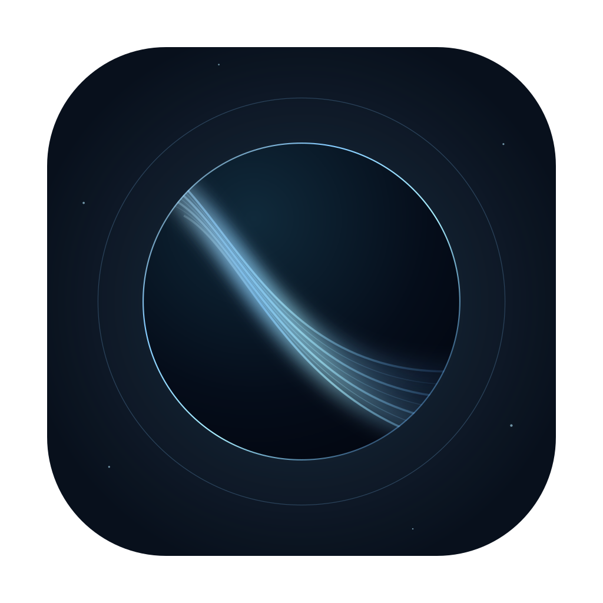

# notdot

**A voice companion for your desktop.**

Talk to an animated orb that listens and replies aloud. notdot works with the ChatGPT Codex app and can remember useful details with your permission.

[Download](https://github.com/kabudu/notdot/releases/latest) · [Getting started](#getting-started) · [Privacy](#privacy-and-memory) · [Roadmap](ROADMAP.md) · [Contributing](CONTRIBUTING.md) · [Apache 2.0](LICENSE)

## Voice demo · [elevenlabs.io](https://elevenlabs.io)

A real wake-word conversation, including a follow-up without repeating “Hey Ava”. Turn on sound to hear both voices.

https://github.com/user-attachments/assets/27db5b3f-e31a-40ee-a8dd-37ecc9c2b6b5

[Read the transcript](docs/demo.md#transcript) · [Download the captioned video](docs/site-assets/demo/notdot-demo-captioned.mp4)

## What you can do

- **Talk naturally.** Say your wake phrase or click once, speak, then pause to send. Press Escape to cancel.
- **Interrupt naturally.** Enable voice interruption to say “Stop”, “Actually…” or a new request during a reply, without a wake phrase. Requires echo cancellation on your computer.
- **Follow up without starting again.** Turn on an optional listening window after replies. Keep talking, or say “That’s all” to stop.
- **Use your other Codex chats.** Find and read relevant history by voice. Optional controls let you send work, add instructions and stop tasks notdot started, with your chosen confirmation setting.
- **Know how work is going.** Ask “What needs me?” or “What’s still running?” Subtle orb cues show work, attention and results. Requested spoken reports distinguish success, failure, partial results and unverified work, while respecting quiet hours.
- **Pick up where you left off.** Continue the same chat after restarting notdot. You can view its history in Codex.
- **Start with guided setup.** Check Codex, sign in and test your voice connection without hunting through settings.
- **Keep notes and lists by voice.** Say “Make a shopping list”, “Add oat milk to that list” or “Read my packing list”. Notes stay on this computer, kept as you said them.
- **Choose what it remembers.** Turn learning on or off, review and edit saved memories, forget individual memories or reset them all. Say what changed, hear the old and new wording, then confirm the replacement.
- **Back up privately.** Save your memories and notes in a password-encrypted file and restore them later, with a preview before anything changes.
- **Share without sharing everything.** Add trusted voices with separate conversations and memories, then choose which Codex chats each person may read or message. Remove someone at any time, or let them remove themselves by voice with a confirmation on screen. Voice matching is a convenience, not authentication.
- **Make it yours.** Choose its name, orb colour, voice and how much it can interrupt you. Ask for settings changes by voice, hear them read back, then approve.

The orb shows when notdot is listening, thinking and speaking. Settings opens when you right-click the orb or use Command/Control + comma.

## Getting started

[Download the latest release](https://github.com/kabudu/notdot/releases/latest) for your computer.

| Platform | Choose this download |
| --- | --- |
| macOS 14 or later | Universal `.dmg` for Apple Silicon and Intel |
| Windows | 64-bit `.exe` installer (unsigned) |
| Linux | AppImage or `.deb` for Intel/AMD 64-bit computers |

To use it, you need:

1. Codex installed and signed into your ChatGPT account.
2. A supported speech service and your own API key. Deepgram can transcribe your speech; ElevenLabs can provide the spoken replies. Service charges may apply.
3. A microphone and speakers or headphones.

Open notdot and follow the setup panel: connect Codex, sign in through your browser if needed, choose a voice and try a conversation. If Codex is missing, the panel links to the official installation guide. You can stop and continue later. After setup, right-click the orb to change Settings.

The [Settings guide](docs/settings.md) explains the options. To build notdot yourself, follow the [developer guide](docs/guide.md).

Use notdot to send messages in its chat. Keep the Codex app for viewing that chat’s history; sending from both apps at once is not supported. The Codex window does not need to stay in the foreground.

## Privacy and memory

Wake detection runs on your computer. Background listening is not sent to a speech service. With voice interruption enabled, speech detected during replies is also sent to your recognition service. Silence stays local. After activation, your chosen services transcribe your request and generate the spoken reply. Codex receives your request and any relevant memories. Notes and lists are the exception: notdot handles them on your computer and does not send them to Codex, although your dictation still goes to the recognition service and anything read back goes to the voice service. If you ask about another local Codex chat, selected messages from that chat are also supplied to the model.

Voice matching runs on your computer. Saved voiceprints are encrypted there, and setup recordings are discarded once a voiceprint is made. Removing a person deletes their voiceprint and private memories.

Saved memories stay on your computer. Turning learning off stops saving and using memories, while keeping existing memories, notes and chat history. Resetting memory does not delete notes, saved Codex chats or backups. Encrypted backups never include keys, sign-ins, saved voices or chat access.

Voice-service keys are stored in your operating system’s credential store. Read [Security](SECURITY.md) for details and how to report a vulnerability.

## Contributing

Bug reports, documentation improvements and focused pull requests are welcome. Start with [Contributing](CONTRIBUTING.md) for setup, tests and the pull-request process. Please follow the [Code of Conduct](CODE_OF_CONDUCT.md).

| Looking for | Start here |
| --- | --- |
| Everyday settings | [Settings guide](docs/settings.md) |
| Build and development instructions | [Developer guide](docs/guide.md) |
| Changes between versions | [Changelog](CHANGELOG.md) |
| Website | [notdot website](https://kabudu.github.io/notdot/) |

## Licence

notdot’s original source code and artwork are licensed under the [Apache License 2.0](LICENSE). The demo’s generated reply audio was made on ElevenLabs’ free plan: it is subject to [ElevenLabs’ non-commercial terms](https://elevenlabs.io/docs/help-center/legal/can-i-publish-the-content-i-generate-on-the-platform), and is not included in the Apache licence grant. Bundled libraries and models keep their own licences; see [Third-party notices](THIRD_PARTY_NOTICES.md).

notdot is an independent project and is not affiliated with OpenAI, Deepgram or ElevenLabs.
