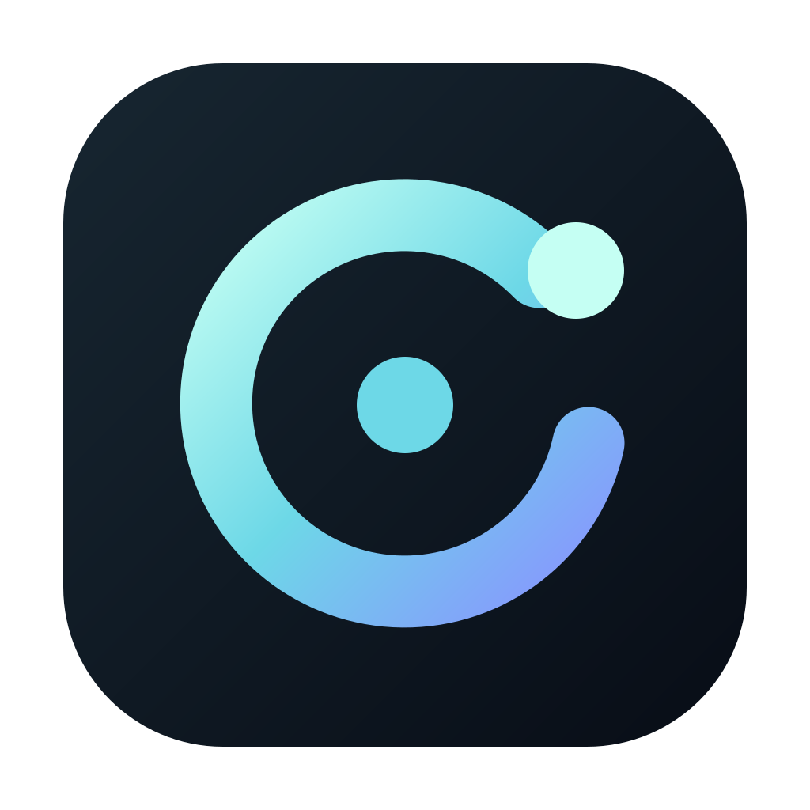

# notdot

**A voice companion for your desktop.**

Talk to an animated orb that listens and replies aloud. notdot works with the ChatGPT Codex app and can remember useful details with your permission.

[Download](https://github.com/kabudu/notdot/releases/latest) · [Getting started](#getting-started) · [Privacy](#privacy-and-memory) · [Roadmap](ROADMAP.md) · [Contributing](CONTRIBUTING.md) · [Apache 2.0](LICENSE)

## See it in action

A real hands-free exchange, with sound and captions. Turn on sound to hear both voices.

https://github.com/user-attachments/assets/c5d0a84b-e8c3-4d9c-877b-d71aad7eb533

[Read the transcript](docs/demo.md#transcript) · [Download the captioned video](docs/site-assets/demo/notdot-demo-captioned.mp4)

## What you can do

- **Talk naturally.** Say your wake phrase or click once, speak, then pause to send. Press Escape to cancel.
- **Keep a conversation going.** Continue the same chat after restarting notdot. You can view its history in Codex.
- **Choose what it remembers.** Turn learning on or off, review and edit saved memories, forget individual notes or reset them all.
- **Make it yours.** Choose its name, orb colour, voice and how much it can interrupt you.

The orb shows when notdot is listening, thinking and speaking. Settings opens when you right-click the orb or use Command/Control + comma.

## Getting started

[Download the latest release](https://github.com/kabudu/notdot/releases/latest) for your computer.

| Platform | Choose this download |
| --- | --- |
| macOS 14 or later | Universal `.dmg` for Apple Silicon and Intel |
| Windows | 64-bit `.exe` installer (unsigned) |
| Linux | AppImage or `.deb` for Intel/AMD 64-bit computers |

To use it, you need:

1. Codex installed and signed into your ChatGPT account.
2. A supported speech service and your own API key. Deepgram can transcribe your speech; ElevenLabs can provide the spoken replies. Service charges may apply.
3. A microphone and speakers or headphones.

Install and open notdot, then right-click the orb to open Settings. Add your speech-service keys, choose a voice and give your companion a name. Click the orb to speak, or enable hands-free listening and use its wake phrase.

The [Settings guide](docs/settings.md) explains the options. To build notdot yourself, follow the [developer guide](docs/guide.md).

Use notdot to send messages in its chat. Keep the Codex app for viewing that chat’s history; sending from both apps at once is not supported. The Codex window does not need to stay in the foreground.

## Privacy and memory

Wake detection runs on your computer. Background listening is not sent to a speech service. After activation, your chosen services transcribe your request and generate the spoken reply. Codex receives your request and any relevant memories.

Saved memories stay on your computer. Turning learning off stops saving and using those notes, while keeping existing notes and chat history. Resetting memory does not delete saved Codex chats or backups.

Voice-service keys are stored in your operating system’s credential store. Read [Security](SECURITY.md) for details and how to report a vulnerability.

## Contributing

Bug reports, documentation improvements and focused pull requests are welcome. Start with [Contributing](CONTRIBUTING.md) for setup, tests and the pull-request process. Please follow the [Code of Conduct](CODE_OF_CONDUCT.md).

| Looking for | Start here |
| --- | --- |
| Everyday settings | [Settings guide](docs/settings.md) |
| Build and development instructions | [Developer guide](docs/guide.md) |
| Changes between versions | [Changelog](CHANGELOG.md) |
| Website | [notdot website](https://kabudu.github.io/notdot/) |

## Licence

notdot’s original source code and artwork are licensed under the [Apache License 2.0](LICENSE). Bundled libraries and models keep their own licences; see [Third-party notices](THIRD_PARTY_NOTICES.md).

notdot is an independent project and is not affiliated with OpenAI, Deepgram or ElevenLabs.
